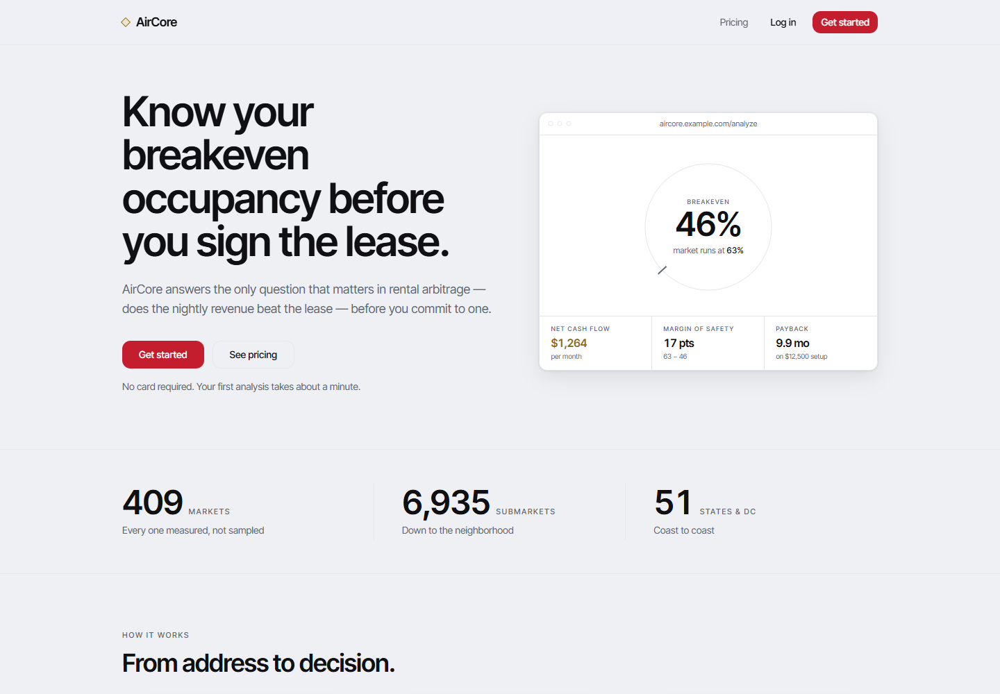

# Alec Minello

**AI Solutions Engineer | AI Implementation & Intelligent Automation**

I bring eight years of sales experience to software delivery. I work with customers to understand the decision they need to make, where their information lives, and what slows them down. Then I build a workflow they can try, explain the tradeoffs, and use their feedback to refine it. I also lead a freelance development team and work directly with clients on requirements and delivery.

[Connect with me on LinkedIn](https://www.linkedin.com/in/alecminello/)

## AirCore at CF Capital Partners

Before committing to a lease, a rental-arbitrage operator needs to know how much occupancy will cover costs and how long it will take to recover the setup expense. As a **Sales Team Lead at CF Capital Partners**, I saw an opportunity to put those decisions and the next landlord conversation in one place. I proposed the solution and independently designed and built AirCore.

I built the workflow around three decisions. Compare income and operating costs. Inspect cash flow, break-even occupancy and payback. Then save the opportunity, record the landlord contact and keep track of the next follow-up. The public page walks through an example. The deal workspace requires sign-in.

**Implementation** · Next.js, React, TypeScript and Supabase. I built the underwriting calculations and connected the research workflow to server-side adapters for AirROI and RentCast. The code also includes an Anthropic-powered research assistant for accounts with access. Visitors can inspect the underwriting example on the public page. [View AirCore](https://360-bnb-solutions-webapp.vercel.app)

## Selected solutions

| Project | What I built | Where to start |
| --- | --- | --- |
| **REI Workspace** | A workspace for investment deals. I connected property discovery and deal analysis with offers, counteroffers, messages and document signing so that users can follow one deal through several decisions. | [Browse the public marketplace](https://reiworkspace.com/marketplace) |
| **Cineasta** | A filmmaking prototype for briefs, references, storyboards and shot planning. The backend includes Supabase authentication, Anthropic planning routes and Stripe checkout and webhook handlers. Guests can try the creative controls with simulated rendering and checkout. | [Enter the guest workspace](https://cineasta.ai/demo) |
| **Sampla** | A music discovery prototype for producers. I built filters for tempo, key, genre and duration around a playable library with saved favorites. The generation interface illustrates a planned capability. | [Explore the sample library](https://sampla.vercel.app/explore) |

## How I deliver

**Discovery and solution design.** I use the same questions in discovery calls and product planning. Who does the work today? What information do they need? What would let the customer tell that the solution worked? At CF Capital Partners, those questions connected a sales team's operational problem to a concrete underwriting workflow.

**AI-assisted implementation.** I use OpenAI Codex and Claude Code to accelerate development. I own the requirements, product decisions, interface design, implementation choices, testing and deployment. When a feature depends on an external service, I distinguish the configured integration from what a visitor can exercise in the demo.

**Validation and handoff.** I work through the customer's task end to end, from the first input to the saved result. I check calculations, state changes and failure paths, then use a working demo to discuss gaps and next steps with stakeholders.

| Area | Technologies and methods |
| --- | --- |
| Application delivery | TypeScript, JavaScript, React, Next.js, Node.js, PostgreSQL, Supabase and Vercel |
| Product and integration design | API integrations, data modeling, interactive prototypes, requirements analysis and workflow automation |
| AI development | Codex and Claude Code for implementation. My areas of study include tool calling, retrieval-augmented generation, LangChain and LangGraph. |
| Customer work | Consultative selling, discovery, technical demonstrations, stakeholder communication, troubleshooting and team leadership |

## More workflows to try

| Demo | A task to try |
| --- | --- |
| [Relay Practice](https://relay-support-practice.vercel.app) | Work through a support scenario, then review the evidence and decisions as a coach. |
| [Daymark](https://employee-onboarding-desk.vercel.app) | Move a contractor to a new team and inspect what happens to completed tasks and access requirements. |
| [Faultline](https://bug-triage-workspace.vercel.app) | Compare two bug reports, inspect the proposed match and follow a fix through verification. |
| [Industry Studio](https://industry-application-studio.vercel.app/) | Explore 13 industry demos, including [bid comparison](https://industry-application-studio.vercel.app/bidroom/), [invoice reconciliation](https://industry-application-studio.vercel.app/clearing/), [dealership operations](https://industry-application-studio.vercel.app/motorhouse/) and [real estate listings](https://industry-application-studio.vercel.app/stillwell/). |

I'm pursuing customer-facing AI solutions engineering and implementation roles where I can own discovery, build integrations and automation, and help customers adopt what we deliver. [Get in touch on LinkedIn](https://www.linkedin.com/in/alecminello/)
